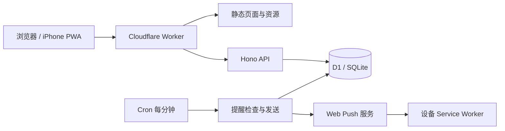

# 架构说明

应用由一个 Worker 和一个 D1 数据库构成。Worker 同时提供 Vite 构建后的静态资源、Hono API 和定时提醒。浏览器与 iPhone 主屏幕 PWA 使用同一套 React 界面。

## 代码入口

| 路径 | 职责 |
| --- | --- |
| `src/App.tsx` | 任务列表、筛选、导航和批量操作 |
| `src/TaskPanel.tsx` | 任务详情、历史、跟进与单项删除恢复 |
| `src/AttachmentUploader.tsx` | 多文件队列、逐项进度与重试 |
| `src/TaskCalendar.tsx`、`src/calendar-data.ts` | FullCalendar 界面与日期映射 |
| `src/Settings.tsx` | 分类、标签、状态、提醒与容量 |
| `src/api.ts` | 浏览器请求与上传接口 |
| `worker/index.ts` | 路由、安全响应头、请求来源检查和定时入口 |
| `worker/auth.ts` | 口令验证、会话与登录限流 |
| `worker/tasks.ts` | 任务、历史、分类、搜索、导出和软删除 |
| `worker/attachments.ts` | D1 文件上传、大小与容量检查、重试幂等 |
| `worker/notifications.ts` | Web Push 订阅、提醒生成与发送重试 |
| `shared/types.ts` | 前后端类型及 API 摘要 |
| `migrations/` | 按顺序执行的 D1 SQL 迁移 |
| `public/sw.js` | 通知接收、点击跳转与离线提示 |
| `tests/`、`scripts/` | 本地验收、初始化及部署验证 |

## 数据与一致性

`tasks` 保存任务当前状态和 `version`。修改时检查版本，避免另一个页面的旧内容覆盖新内容。`activities` 保存文本记录和结构化变化；任务写入与对应历史尽量在同一个 D1 批处理中提交。

`taxonomies` 统一表示分类、标签与状态。分类和标签通过 `task_taxonomies` 与任务建立多对多关系；状态只有一个，状态的 `is_closed` 决定任务是否归档。`parent_id` 表示跟进关系。

删除仅设置 `deleted_at`。正常列表、归档和日程排除已删除任务，回收站允许查看与恢复。批量删除要求所有选中任务版本匹配，否则整批不变；跟进任务不自动随父任务删除。

附件文件直接作为 BLOB 保存在 `attachments`。文件、附件元数据、上传历史和任务版本在一个事务中提交，没有外部对象存储。客户端在一次队列及其重试中保留上传 UUID；服务器已经保存时，重试返回同一附件。刷新页面后重新选文件会产生新的上传编号。

容量检查读取 D1 返回的实际数据库大小，包含索引和数据库页，并为后续记录保留空间。并发上传还检查附件总量的快照，避免同时消费同一份估算余量。平台自身的数据库容量限制仍可能拒绝写入，接口会保留已有数据并返回错误。

迁移中的 `storage_key`、`attachment_uploads` 来自早期存储准备工作；当前实现不依赖 R2，也不向对象存储写文件。保留已发布的迁移有助于已有数据库按相同顺序升级。

## 登录与私人数据

应用为单用户共享口令设计。`APP_PASSWORD` 放在 Worker secret 中；会话使用随机令牌，D1 仅保存其哈希与过期时间。正式 HTTPS Cookie 使用 `HttpOnly`、`Secure` 和 `SameSite=Strict`。API 会检查写请求来源，私人响应禁止缓存，附件下载也要求登录。

静态应用资源公开，任务与文件接口受登录保护。Service Worker 不缓存私人 API 数据，只有公开资源及离线提示；本地和云端数据库不自动同步。

## 提醒

Cron 每分钟生成和处理到期提醒，通知记录保存在 `notifications`，订阅保存在 `push_subscriptions`。提醒采用唯一键、发送占用期限与重试记录降低重复发送。完成、改期和删除会重新核对未发提醒；已删除任务不生成新提醒。

Web Push 是外部服务，服务接受与 D1 记录无法组成一个原子事务，因此极端故障仍可能重复投递，通知 tag 用于在设备侧合并。每轮发送数量受限，大量到期任务会排队。未配置 VAPID 时不会发送真实推送；邮件字段尚未接入发送服务。

## 适合从哪里扩展

- 新的任务字段：依次添加数据库迁移、共享类型、服务端校验和前端编辑控件。
- 新的筛选或视图：复用现有任务查询与截止时间语义，保持无截止日期任务可见。
- 邮件渠道：在现有提醒记录与重试机制上实现适配器，再增加配置和状态反馈。
- 大文件存储：需要额外设计存储、额度、删除、备份与恢复流程，不能只提高文件上限。
- 多用户：需要增加用户身份、所有权和所有查询的权限边界；当前共享口令不提供租户隔离。

完整复现步骤、备份限制和实机验收要求见 [README](../README.md)。
